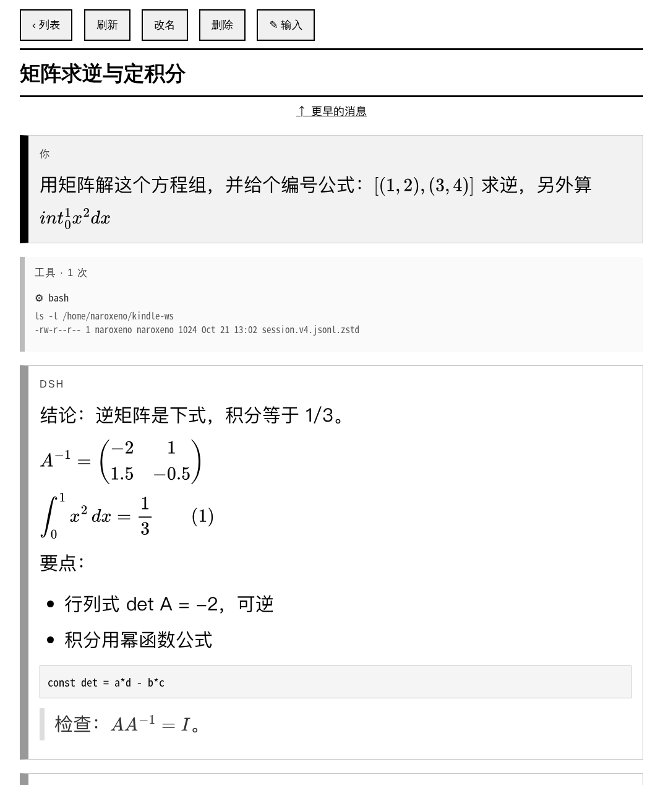

# DSH for Kindle

在 Kindle 原生浏览器里用 [DeepSeek Harness](https://github.com/deepseek-ai/deepseek-harness)。



Kindle Paperwhite 的浏览器是 WebKit 534（2010 年前后，约等于 Safari 4/5）：没有
flexbox、没有 Promise、没有 `fetch`、没有 `position: fixed`、点击只有 `click`。
DSH 自带的 Web GUI 是 Vite + React 单页应用，在它上面打不开。

这个插件**不改动 Host**，只是在 Host 进程里多挂一个独立的极简 HTTP 服务（默认
`8090`）：页面全部在服务端渲染成 ES5 浏览器也能吃的 HTML，公式在服务端用 MathJax
转成内联 SVG，浏览器端只有一百来行自己写的脚本，负责轮询新消息。

在 Kindle Paperwhite 4（固件 5.14.2，"KPW4"）上实测可用，页面宽 1072px。

## 能做什么

| 功能 | 说明 |
| --- | --- |
| 会话列表 | 标题、时间、生成中标记；标题搜索框（子串、不区分大小写）；新建、进入 |
| 对话 | 你 / DSH / 工具调用三种消息块（10px 色条 + 底色）；生成中自动追加新消息，不整页刷新 |
| 公式输入 | 用 AsciiMath 写 `$sum_(i=1)^n i$`，发送时转成 LaTeX 交给模型；18 个模板键，可先"预览公式"再发 |
| 公式显示 | 服务端 MathJax → 内联 SVG（矩阵、积分、`\tag` 编号都支持；渲染失败显示源码而不是黑块） |
| 会话管理 | 改名、分叉、删除（归档）、分页看更早的消息 |
| 分组 | 在 `/settings` 指定默认工作区；Kindle 建的会话直接落进该工作区的分组，不再被 GUI 丢进「未分组」 |
| 余额 | 列表页一行 + `/me` 账户页（平台钱包：充值余额、赠送余额、用量与充值链接） |
| 峰谷价签 | 标题栏显示现在算「峰时」还是「谷时」：高峰单价是空闲的两倍（工作日 9–12 点、14–18 点） |
| 思考强度 | 会话页「低 / 高 / 最大」，按当前模型支持的能力显示，切换对下一次请求生效 |
| 阅读端提示词 | 每个 Kindle 会话自动注入一段系统提示词：先给结论、默认 300 字内、不用表格、公式只用 LaTeX |
| Markdown 预览 | 会话页「文件」列出当前工作区的 `*.md`（递归三层、按修改时间），点开即读；正文里的链接和裸路径也能继续点下一篇 |

## 环境

- dsh `>= 0.2.1-rc.1 < 0.3.0`（0.2.1-rc.2、0.2.2-alpha.2 实测）
- Node.js `>= 20`
- 浏览器：Kindle Paperwhite（实测 KPW4 / 固件 5.14.2）；其他 WebKit 534 级别的老浏览器大概率也能用
- 设备与 Host 在同一局域网，或你自建了内网穿透

首次安装会下载约 45 MB 依赖（`mathjax-full`），之后不联网。

## 安装

### 通过插件界面

打开 DSH Web GUI 的 **Plugins**，在安装入口填 `dsh-kindle`，确认即可。界面会同时把它
写进 profile 的依赖和 `dsh.profile.bundles`，装完重启 dsh。

### 通过命令行

```bash
dsh plugin --profile web add dsh-kindle
```

它会装包并自动把 `dsh-kindle` 加进 profile 的 `dsh.profile.bundles`。然后重启 dsh。

## 配置

安装后插件的默认配置写在它自己的 `cordis.patch.yml` 里。要改，编辑你 profile 的
`cordis.patch.yml`（`~/.dsh/profiles/<name>/cordis.patch.yml`）。这个文件初始内容是
`[]`，把它**整个换成一个列表**（不要往 `[]` 后面追加条目）：

`config` 会被整体替换，所以要把所有字段重写一遍：

```yaml
- id: kindle-ui
  name: dsh-kindle
  config:
    host: 0.0.0.0
    port: 8091
    cwd: '~/kindle-ws'
    fontSize: 30
    pageSize: 6
    token: ''
```

| 字段 | 默认 | 说明 |
| --- | --- | --- |
| `host` | `0.0.0.0` | 监听地址。只在本机用可改成 `127.0.0.1` |
| `port` | `8090` | 监听端口，和 Web GUI 的 3080 无关 |
| `cwd` | `~/kindle-ws` | 会话工作目录的初始默认；也用来限定"哪些会话能在 Kindle 上看到"。要换请在 Kindle 的 `/settings` 页改 |
| `fontSize` | `30` | 正文 px。Kindle 上 28–34 比较舒服 |
| `pageSize` | `6` | 会话页最多先渲染多少条消息，更早的点「↑ 更早的消息」加载 |
| `token` | `''` | 空 = 自动生成；`off` = 关闭鉴权（只建议本机）；也可以直接写死一个字符串 |
| `hotReload` | `true` | 改完 `lib/*.js` / `prompt/kindle.md` 后下一次请求自动换新代码；设成 `false` 则恢复“重启才生效” |

登录：启动日志里会打印一条 `kindle login link`，在 Kindle 上打开一次即可（会种下一年期
HttpOnly cookie）：

```
kindle UI listening on http://192.168.1.10:8090/s (workspace /home/you/kindle-ws)
kindle login link (open once on the device): http://192.168.1.10:8090/login?t=<token>
```

自动生成的 token 存在 `<cwd>/.kindle-token`（权限 600）。想换一个：删掉这个文件再重启。

### 默认工作区与分组

Kindle 新建的会话会挂在「默认工作区」这个分组里，不再出现在 GUI 的「未分组」。改法：Kindle
首页右上角 **设置** 页——

- 点列表里的某个已注册工作区，直接切过去；
- 或在「其他目录」里填一个已存在的目录（支持 `~/xxx`）。

保存会做两件事：把选择写进 `<cwd>/.kindle-settings.json` 的 `{"workspace": "…"}`
（用配置里的 `cwd` 当锚点，所以不随 Kindle 页面变），并把这个目录里**之前建的**会话一起归组；
没赶上批量的，页面底下还有「把 N 个旧会话归组」。切目录后列表只显示新目录的会话，切回去
就又能看见旧的。

### 峰谷价签

标题栏的「峰时 / 谷时」是本地算的，不发请求。原因：DSH 的账户接口只返回钱包余额，没有价格
时段字段；`dsh-cost-meter` 插件虽然有这套逻辑（它侧栏的峰谷倒计时、切换前提醒就是），但没把
「现在是峰还是谷」暴露给别的插件——它的设置只存在 `~/.dsh/storages/cost-meter/ledger.json`
的 `config.peakWindows` / `config.peakHolidays` 里，对外只有给 Web 客户端用的
`costMeter.getState()`。

所以规则和节假日表都在 `src/account.ts`：工作日 9:00–12:00、14:00–18:00 算峰时，`HOLIDAYS`
里的法定节假日算谷时（按国务院放假通知，现在收录到 2027 年，每年 11 月补下一年）。以后账户
接口或 cost-meter 要是提供查询接口，改 `priceWindow()` 的实现即可，UI 不用动。

## 安全

**这个 token 等价于 Host 的 shell 权限。** Kindle 会话里运行的 Agent 用的是你 profile 的
权限（很多人是 `danger-full-access`），拿到 token 的人可以在你的机器上执行命令。

- 不要把它暴露到公网。学校里用，建议 frp 的 `type = http` 或 `type = tcp` 穿透，
  **不要**用强制 HTTPS 的隧道（Cloudflare Tunnel / ngrok 之类）——旧 WebKit 的 TLS 栈
  协商不下来，而且这里的页面本来就是纯 HTTP。
- 用完把穿透关掉，或每次换一个 token。
- 不确定时，把 `host` 改成 `127.0.0.1`，用 SSH 端口转发。

## 已知限制

- 不是流式：生成中每 3 秒轮询一次增量片段，空闲降到 15 秒、25 轮后停。所以看到的是
  "一段一段"的长出来，不是逐字。
- 不支持图片：模型回复里的图片不会显示（WebKit 534 上图片解码也不划算）。
- Markdown 是精简实现：段落、标题、列表、引用、代码块、表格、链接、粗斜体；
  没有脚注、任务列表、HTML 透传。
- 会话页一次渲染 `pageSize` 条，很长的会话需要翻页。
- 服务器读不到半个 JSON 行时会降级成"空会话 + 生成中"，刷新即可恢复。
- 删除是归档：文件仍在 `~/.dsh/sessions/...` 里，电脑端可以找回。
- 峰谷价签用的是本地日期表，法定节假日要每年 11 月手动补到下一年（现在收录到 2027 年）。

## 开发

```bash
npm test          # 渲染 + HTTP + 热重载 + 真 Chromium 轮询回归
npm run pack:check
```

调试页 `/debug`（需要登录）会输出插件版本、热重载代次、提示词注册状态、余额服务与模型目录的可用性。

```
kindle-ui 0.5.0
hot: generation 1 (0 reloads, auto on)
{"registered":1,"lastError":"","section":"kindle:display"}
prompt bytes 1066
delete (workspace services): ready
account (balance): ready
model catalog: deepseek-official/deepseek-flash (low,high,max)
```

### 热重载

改完 `lib/*.js` 或 `prompt/kindle.md` **不用重启 dsh**：下一次 HTTP 请求会用新代码，
`/debug` 里的 `generation` 加一。`GET /debug?reload=1` 可以手动换一代；新代码有语法错误时
服务继续跑上一代，错误显示在 `/debug` 的 `hot error:` 行，修好后再请求即恢复。

只有 `lib/index.js`、`lib/hot.js` 和 `cordis.patch.yml`（配置）仍需要重启——这几处是壳，
本身不能热替换。装好/升级插件后的第一次启动也仍要重启 dsh。

```bash
# 改完文件后，在电脑上确认换了代
curl -s -b /tmp/kd.jar http://127.0.0.1:8090/debug | head -3
```

## 许可

MIT。第三方：MathJax（Apache-2.0）、asciimath-to-latex（MIT）。
