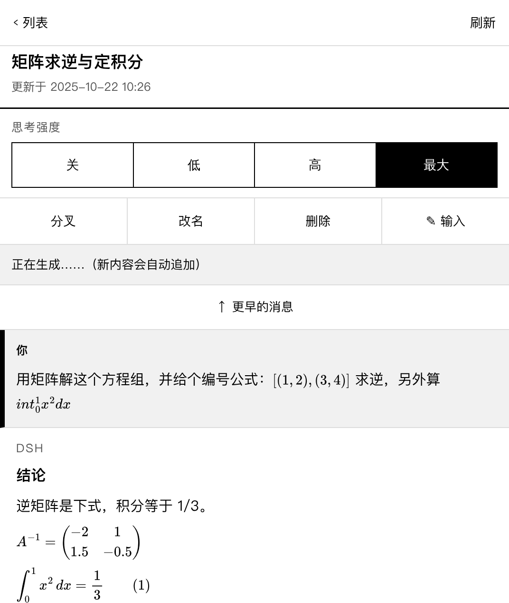
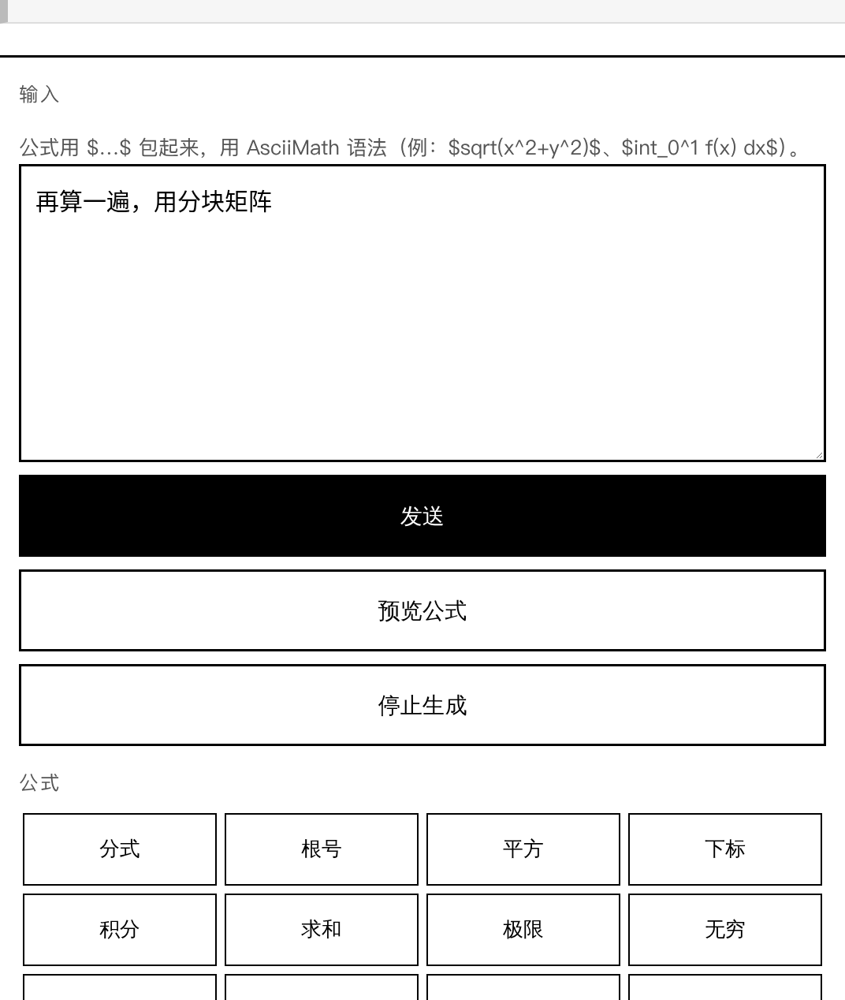
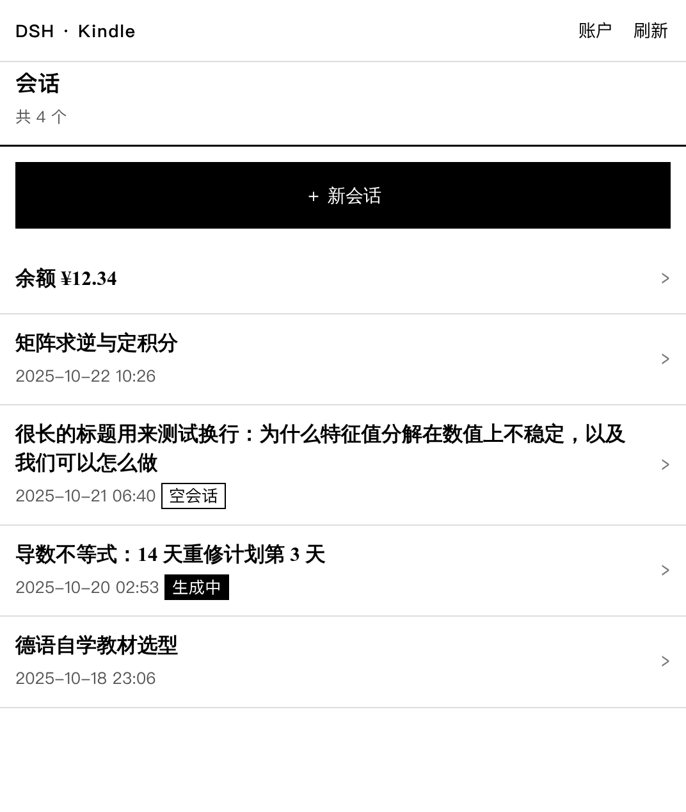

# DSH for Kindle

给 **Kindle Paperwhite 4（固件 5.14.2）原生浏览器**用的 DeepSeek Harness 前端。

> 换会话/换人接手，先读 [`HANDOFF.md`](HANDOFF.md)：运行状态、代码地图、Host API、踩过的坑、待办。
> 本文偏用户文档，HANDOFF 偏工程交接。

它不是一个 SPA：Kindle 的 WebKit 531/534（≈ Safari 4/5，2009–2011）跑不了现在的 Web GUI，
所以这一版把一切都放在电脑端做——**服务端渲染整页 HTML**，公式在服务端用 MathJax 转成
**内联 SVG**，Kindle 只需要一个能显示 HTML 的浏览器。

```
Kindle 浏览器  ──HTTP(局域网/穿透)──▶  node http 监听 :8090  ──ctx.sessionController──▶  DSH Host
   ES5 子集                          服务端渲染/鉴权/公式             会话、turn、工具调用
```

## 目录

```
kindle-dsh/
├── bundle/                 # 插件包 dsh-kindle（已装进 web profile）
│   ├── cordis.patch.yml    #   config：端口、工作区、字号、分页、token、hotReload
│   ├── lib/index.js        #   插件入口：只挂载 hot.js
│   ├── lib/hot.js          #   稳定壳：http 监听、鉴权、按文件指纹换代码代
│   ├── lib/app.js          #   可热重载的一代：路由、页面、错误页
│   ├── lib/sessions.js     #   sessionController 适配层（列表/发送/停止/读日志）
│   ├── lib/math.js         #   AsciiMath→LaTeX、TeX→SVG→px
│   ├── lib/markdown.js     #   极简 markdown 渲染（含 $…$ / $$…$$）
│   ├── lib/ui.js           #   服务端 HTML + 公式键盘 + 轮询脚本
│   ├── lib/prompt.js       #   按会话注册阅读端系统提示词
│   └── test/               #   渲染 / HTTP / 热重载 / 真浏览器用例
└── spike/                  # 阶段 0 真机自检页（设备能力探针，留作记录）
```

## 现在的状态

- 插件 `dsh-kindle` 已通过 plugin_manager 装进 `web` profile，监听 `0.0.0.0:8090`。
- 已有页面：登录、会话列表、会话（分页 + 输入 + 公式键盘 + 预览 + 停止 + 增量追加刷新）。
- 已在真的 KPW4 上验证过：WebKit 534.26、无 `fetch`/`Promise`/`flex`/`grid`、
  `position:fixed` 失效、外链 `` 渲染失败（0×0）而**内联 SVG 正常**、
  整页渲染约 3.5 秒。
- 会话按工作区隔离：本 UI 只列/只开 `cwd = ~/kindle-ws` 的会话，不会碰到你在电脑上用的会话。

## 用法

1. 插件升级后**重启一次 dsh**（`Ctrl-C` 再 `dsh web`），让新的入口模块生效；之后改
   `lib/*.js`、`prompt/kindle.md` 都不用再重启，详见「开发 / 热重载」。
2. Kindle 浏览器打开（只需一次）：
   ```
   http://192.168.10.40:8090/login?t=d9cf6e9e9a81d235f986bc55
   ```
   这个链接会种下有效期一年的 cookie，之后直接开 `http://192.168.10.40:8090/s` 就行。
3. 「＋ 新会话」→ 打字 → 「发送」。生成中页面每 3 秒问一次状态、日志一动就整页刷新。
4. 公式用 `$…$` 包起来，写 **AsciiMath**：

   | 想要 | 这样写 |
   | --- | --- |
   | 二次方程求根 | `$x = frac(-b +- sqrt(b^2-4ac))(2a)$` |
   | 积分 | `$int_0^1 f(x) dx$` |
   | 求和 | `$sum_(i=1)^n i$` |
   | 分数 | `$frac(1)(2)$` |

   发送时 `$…$` 段会被转成 LaTeX 再交给模型（模型看到的是 `\frac{...}` 这类），
   显示时一律按 TeX 渲染成内联 SVG。「预览公式」按钮可以先看一眼渲染结果。

## 配置

改 `bundle/cordis.patch.yml` 里的 `config`，然后重启 dsh（配置只在启动时读一次）：

| 键 | 默认 | 说明 |
| --- | --- | --- |
| `host` | `0.0.0.0` | 监听地址；只用本机时改 `127.0.0.1` 更安全 |
| `port` | `8090` | 端口 |
| `cwd` | `~/kindle-ws` | Kindle 会话所在工作区（列表与新建都限定在这里） |
| `fontSize` | `30` | 正文字号（CSS px；KPW4 视口 1072×1268） |
| `pageSize` | `6` | 每页消息数，「更早的消息」会按它翻页 |
| `token` | `''` | 留空 = 自动生成并存在 `~/kindle-ws/.kindle-token`；写 `off` = 关闭鉴权（仅本机调试） |
| `hotReload` | `true` | 改完代码/prompt 后下一次请求自动生效；设 `false` 则退回“重启才生效” |

token 的三个来源（按优先级）：`config.token` → 环境变量 `DSH_KINDLE_TOKEN` →
`<cwd>/.kindle-token`（不存在就生成一个 24 位十六进制串，权限 600）。

## 给 Kindle 会话的提示词

Kindle 会话会比 GUI 会话多一个系统提示词段，内容在 `bundle/prompt/kindle.md`（改完下一次请求生效，见「开发 / 热重载」）。
它约束的是「输出要适合 e-ink 小屏」：先给结论、默认 300 字内、不要表格/多层列表/ASCII 图、
代码只贴关键行、公式一律 LaTeX、别把命令输出整段贴回来。

挂载方式是**按会话注册**，不是全局：打开某个 Kindle 会话时，插件取到该会话的 agent，
在它的 `systemPrompt` 上注册 `kindle:display` 段（order 10200，排在最后）。所以

- 只影响 `~/kindle-ws` 里的会话，GUI 里其它会话完全不受影响；
- agent 重建后会重新注册，不会丢；
- 注册失败不影响页面，错误记在 `GET /debug`：

```bash
curl -H 'Cookie: kd=<token>' http://192.168.10.40:8090/debug
# kindle-ui 0.3.1
# hot: generation 1 (0 reloads, auto on)
# {"registered":1,"lastError":"","section":"kindle:display"}
# prompt bytes: 1066
```

`registered` 从 0 变 1 就说明这段提示词真的进到模型上下文了。

## 会话管理

列表页每行三个操作，会话页顶部也有「改名 / 删除」：

| 操作 | 行为 |
| --- | --- |
| 分叉 | 立刻从「最近一个完整轮次」复制出一个新会话并跳过去；原会话不动 |
| 改名 | 单独一页输入新标题（`sessionController.rename`），只影响显示 |
| 删除 | 先到确认页，确认后调 `workspaceController.archiveSession`：从列表移除，会话文件仍留在 `~/kindle-ws`，电脑端可以找回；正在生成的会话会先被停止 |

「删除」其实是**归档**，因为 Host 没有硬删除 API。归档集由 workspace 注册表统一维护，
所以 Kindle 端删掉的会话在 Web GUI 里也隐藏，反过来 GUI 里归档的也不会出现在 Kindle 列表。

## 余额与思考强度

**余额**：列表页标题下有一行「余额 ¥12.34」（链接到 `/me`），`/me` 页显示充值余额、赠送余额，
以及平台给的「查看用量 / 去充值」链接。数据来自 `ctx.accountController`——和 Web GUI 账户页
用的是同一个服务（`getBalance`），Host 端缓存 120 秒，列表页最多等 2.5 秒，等不到就不显示，
不会拖慢列表。没登录平台账号、或 Host 没挂载账户扩展时，`/me` 会说明原因而不是报错。

**思考强度**：会话页标题下面一行「思考 低 / 高 / 最大」，黑色那个是当前档位。
可选项来自 `sessionController.modelCatalog()` 里该模型的 `reasoning.efforts`，当前值来自
`modelSelection` 投影；点一下会 `POST /c/:id/effort` → `sessionController.selectModel({provider, model, reasoningEffort})`，
只影响下一次请求。模型没有推理档位时（比如普通对话模型）这一行整个不出现。

> 注意：`selectModel` 会**唤醒**这个会话的 Agent，所以点完到跳回页面可能等几秒；
> 这也是为什么这个控件只放在会话页，列表页不碰。

## 内网穿透（在学校用）

Kindle 只支持很老的 TLS，**不要**用强制 HTTPS 的隧道（Cloudflare Tunnel、ngrok 的 https 域名），
否则浏览器会直接连不上。推荐在电脑上跑 frp：

```ini
# frpc.ini —— 把 8090 以纯 HTTP 暴露出去
[school-kindle]
type = http          # 或 tcp + remote_port
local_ip = 127.0.0.1
local_port = 8090
custom_domains = kindle.你的域名
```

安全提醒：这个 UI 背后是一个**有 shell 权限的 agent**（cwd 在 `~/kindle-ws`，权限预设继承 profile）。
token 等于密码，别外泄；不放心的话在穿透那一侧再加一层 basic auth / IP 白名单，或只在需要时开隧道。

## 开发

### 热重载（0.3.0）

改完 `lib/*.js` 或 `prompt/kindle.md` 后**不用重启 dsh**：下一次 HTTP 请求会用新代码，
端口、cookie、监听都不受影响。`/debug` 的 `generation` 会加一，`reloads` 是累计换代数。

实现分两层：

- `lib/index.js` + `lib/hot.js` 是**稳定壳**，只在进程启动时加载：配置归一化、token、HTTP
  监听、登录/鉴权、请求分发。它每 250ms 最多检查一次文件指纹（size + mtime），变了就
  `import('./app.js?gen=N')`。
- `lib/app.js` 是**可替换的一代**，承载路由与页面；它把同一个 `?gen=N` 传给
  `sessions/math/ui/markdown/prompt/account`，所以一次请求里不会新旧代码混用。
- 新代码加载失败时继续服务上一代，错误显示在 `/debug` 的 `hot error:` 行；同一份坏文件不会
  反复重试。`GET /debug?reload=1` 可以手动换一代。
- MathJax 实例与 SVG 缓存、按 agent 的提示词注册放在 `globalThis` 的 Symbol 槽里跨代共享；
  提示词文本变化时先撤销旧段再注册，避免 `already registered`。

仍然需要重启的只有：`lib/index.js`、`lib/hot.js`、`cordis.patch.yml`（配置），以及升级插件后的
第一次启动。配置里 `hotReload: false` 可以整体关掉热重载。

### 测试

不需要真机、也不需要 DSH：

```bash
cd bundle
npm test                       # 渲染、HTTP 端到端、热重载、真浏览器
node test/render-test.mjs      # markdown + 公式 → HTML/SVG；含矩阵、\tag、坏公式兜底
node test/server-test.mjs      # 假 sessionController + 真 http（:8091），28 项
node test/hot-test.mjs         # 临时副本 + 真 http（:8094）：换代码、依赖链、坏文件降级、手动换代
node test/integration-test.mjs # 真 cordis + stub 服务（:8092），7 项，验证 inject 作用域与归档
node test/browser-test.mjs     # 真 Chromium（:8093）跑页面里的轮询脚本，验证增量追加
                               # 没有 chromium 时自动跳过，可用 CHROMIUM=/path/to/chrome 指定
```

`/debug`（登录后可访问）会回报当前插件版本、热重载代次、提示词段是否注册、以及 `delete`
依赖的 workspace 服务是否就绪——升级后先看它，比翻日志快。

想把一份真实会话日志塞进渲染器看效果：

```bash
node test/replay-test.mjs /home/naroxeno/.dsh/sessions/--home-naroxeno-kindle-ws--/session-<id>/session.v4.jsonl.zstd
```

`spike/` 里是阶段 0 的真机自检页（`node spike/server.mjs`，:8090）：它把 UA、视口、
`fetch`/`Promise`/flex/grid/内联 SVG/`img+svg`/cookie/localStorage 一次性测出来并回报。
换新机型（比如 KPW5、Kindle Scribe）时先跑它，再改 `fontSize`。

## 0.1.1 修了什么

三个真机 bug 的根因都不在 Kindle 一侧：

1. **矩阵、带编号公式变成黑块**：`mathjax-full/js/input/tex.js` 只带 base 包，`egin{pmatrix}`
   这类 ams 环境根本没注册，MathJax 于是画了个 `merror` 红框（e-ink 上就是黑块）。现在改用
   `input/tex/AllPackages.js` 全量注册；无法解析的公式不再画错误框，而是显示等宽的原始 TeX
   （`.matherr`）。`\tag{1}` 在只取 SVG 节点的输出里会被丢掉，所以转换前把它折成
   `\qquad\text{(1)}` 跟在公式后面。
2. **删除会话 409**：`ctx.workspaceController` 在没写进 `inject` 的插件里读取会直接抛
   `cannot get property "workspaceController" without inject`。现在插件仍只硬依赖
   `sessionController`，workspace 的两个服务放进 `ctx.inject([...])` 子作用域里按需解析——
   归档是锦上添花，缺了它整个阅读端也不该起不来。
3. **偶发"加载错误"**：一是 WebKit 534 会复用服务端已经关掉的 keep-alive 连接，然后显示自己的
   错误页；现在所有响应都带 `Connection: close`（页面本来就要 3.5 秒，省下的握手不值得）。
   二是生成中读会话日志可能读到写了一半的行，以前直接 500，现在降级成"空会话 + 轮询"，下一轮
   自动恢复。

## 0.1.2 增量刷新

以前有新内容就 `location.reload()`，一次 ~3.5 秒，还会把输入框里的草稿冲掉。现在会话页
只拉新增部分：

1. 页面首次仍是服务端整页渲染，并把「最后一条消息的 seq」写进脚本当游标。
2. 脚本 `GET /c/:id/tail?since=<游标>`，服务端返回
   `{mode:'append'|'replace', html, cursor, running}`。
   - 游标仍在当前窗口里、且没有更早的消息被改写 → `append`：只渲染游标之后的消息，客户端
     `insertAdjacentHTML('beforeend', …)` 追加，不重排整页、不动输入框。
   - 否则（翻过页、轮次改写了旧条目、游标找不到）→ `replace`：整段消息列表替换。
3. 生成中 3 秒一轮，空闲 15 秒一轮，空闲 25 轮后停；只有 `running` 才显示「停止生成」。
4. 追加时若用户正停在页底才自动跟到底部，否则保持阅读位置。

代价：消息列表是服务端渲染的 HTML 片段，所以每次追加仍要重新排版（e-ink 整屏刷新约 1 秒），
但省掉了 3.5 秒的整页解析 + 脚本启动，且草稿、滚轮位置、展开状态都不丢。

## 排版

目标屏是 KPW4：1072×1268 可视区、dpr 约 1.8、每次重画约 1 秒，所以排版按「大字、少滚动、少视觉噪音」做，
所有尺寸以 `fontSize` 为基准（`em`），换机型只改一个数。



- **正文**：会话页强制用黑体栈（`"STHeiti","Heiti SC","PingFang SC","Microsoft YaHei","Droid Sans Fallback",…,sans-serif`），
  30px、行高 1.72、左右 32px 边距，一屏约 33 个汉字/行；页面标题 `h1` 仍用 serif（`.hei h1{font-family:serif}`），
  输入框跟随正文黑体。列表/登录等页面保持 serif。
- **区分说话人**：不用头像和气泡尾巴，改用左侧 14px 色条——你是黑条 + 浅灰底，DSH 是灰条 + 白底，
  标题行小字「你 / DSH」。扫一眼就知道谁在说。
- **工具调用合并**：连续的工具结果并成一块浅灰日志（`工具 · N 次`），每条只留 160 字并保留换行，
  不再一个工具一个框把回答顶出屏幕。
- **导航**：5 个大按钮（列表 / 刷新 / 改名 / 删除 / ✎ 输入），点击区域 18px 内边距，墨水屏上不用瞄准。
- **生成中**：只有真的在生成时才出现描边徽标；刚发送和生成期间自动滚到最新，平时不抢你的阅读位置。



- **输入区**：9em 高的 textarea、黑底「发送」、18 个公式键按 6 列排布（0.56em 标签，手指点得中）。
- **列表页**：标题加粗整行可点，「生成中 / 空会话」做成小徽标，分叉/改名/删除收成一排小按钮。



注意：这些尺寸是按 1072 宽调的；屏更窄的机型（K4/KT）把 `fontSize` 调到 26–28，或把 `body` 的左右
padding 从 32px 降到 20px。

## 0.1.5 修了什么

**增量刷新在真机上完全没跑起来**：页面脚本里 `if(jump)` 引用了一个没声明的变量（`jump` 只写在
函数签名里，拼进内联脚本时丢了），WebKit 一执行就 `ReferenceError`，整个 IIFE 当场退出，于是
既没有轮询、也没有报错——表现就是"AI 回复完了页面不动"。

- 现在 `jump` / `fresh` 都显式拼进 `var` 声明。
- 加了一个**真浏览器**回归用例：起假会话、打开页面、在第一次 `/tail` 轮询时追加一条助手消息，
  再用 `chromium --virtual-time-budget` dump DOM，断言新消息确实追加到了页面上。把修复回退掉时
  这个用例会失败（已验证），不再靠人眼判断。
- 顺手把"刚发送后"的轮询间隔改成 4 秒（前 12 轮），因为 turn 尚未被标记为 running 时以前要等 15 秒。

## 0.1.6 加了什么

- **查看余额**：新增 `/me`，列表页显示缓存的余额行；走 `accountController.getBalance`
  （平台钱包），失败/未登录/无服务都有对应文案，不会让页面报错。
- **调整思考强度**：会话页新增「思考 低/高/最大」切换，按 `modelCatalog()` 给出的档位渲染，
  当前档位置黑；`POST /c/:id/effort` 调 `selectModel`，对下一次请求生效。
- `/debug` 多了两行：`account (balance): ready|missing` 和 `model catalog: provider/model (low,high,max)`。
- 服务端测试加到 26 项（余额行、账户页、档位栏、切档位、非法档位 400）。

## 已知限制 / 下一步

- **没有流式输出**：助手消息在每一步结束时才落日志，所以是「步进式追加」而不是逐字流式；
  每步约 3 秒后才出现在页面上。
- 手动点导航里的「刷新」或发送后跳转仍会整页重载（约 3.5 秒），增量只作用于停在同一页时的更新。
- 不支持发图片/附件（可以加：POST 上传 → `content:[{type:'image',…}]`）。
- 生成长回答时只显示最近 N 条，翻页靠 `?n=`。
- 公式键盘只有 18 个常用模板，没有全量 AsciiMath 符号表。
- 手动刷新/发送跳转会丢掉输入框里的草稿（自动追加不会）。
- 删除是归档，不是抹掉磁盘文件；要真删得手动清 `~/kindle-ws` 对应目录。
- 分叉没有确认页（按一下就建新会话），误点会在列表里多一个会话。
- 余额是平台钱包的余额；如果你用的是自己的 API key 计费，DeepSeek 的 `/user/balance`
  这里没接（那需要直接读 key 去调接口），要的话可以加。
